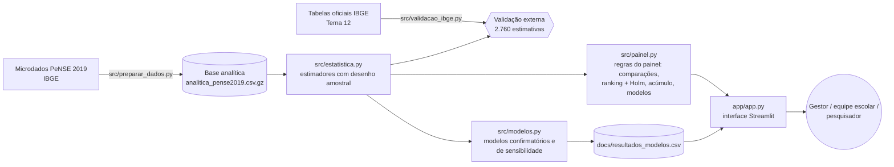
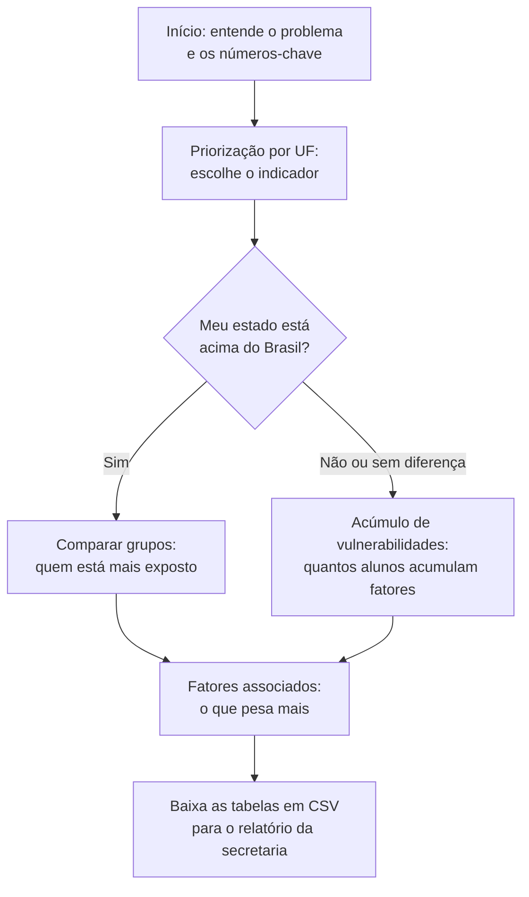

# Proposta da solução, requisitos e modelagem

Documento que responde diretamente ao **edital FMU TECH Inovação 2026.2**: os cinco itens que
cada grupo deve definir (seção 2 do edital) e as entregas do 2º semestre (seção 4: compreensão do
problema, análise inicial dos dados, **requisitos da solução** e **modelagem ou protótipo**).

## 1. Ficha do projeto (itens obrigatórios do edital)

| Item do edital | Definição do grupo |
|---|---|
| **Título do projeto** | Observatório Estatístico de Saúde Mental e Vulnerabilidades Psicossociais. Título da pesquisa: *Sofrimento psicológico e vulnerabilidades psicossociais em escolares brasileiros: análise estatística da PeNSE 2019* |
| **Problema** | Cerca de 1 em cada 5 escolares de 13 a 17 anos (17,7%) relata sofrimento psicológico frequente. Gestores de educação não têm uma ferramenta simples, com margem de erro correta, para saber **quais grupos** estão mais expostos, **onde** a situação é pior e **quais fatores** do convívio escolar e familiar acompanham esse sofrimento. |
| **Público / contexto** | Usuários: secretarias de educação, gestores escolares, equipes pedagógicas e psicólogos escolares, pesquisadores. População estudada: alunos de 13 a 17 anos de escolas públicas e privadas do Brasil (ODS 3, meta 3.4: promover a saúde mental e o bem-estar). |
| **Bases de dados públicas** | PeNSE 2019 – microdados e dicionário oficial (IBGE/Ministério da Saúde); tabelas oficiais do IBGE, Tema 12 – Saúde Mental (usadas para validar os nossos cálculos). Ver `relatorio_dados.md`. |
| **Proposta de solução tecnológica** | Painel web interativo (Python + Streamlit) que calcula, em tempo real e com o desenho amostral da pesquisa, prevalências, comparações entre grupos, ranking de UFs com correção para múltiplas comparações, acúmulo de vulnerabilidades e modelos de regressão ajustados, com interpretação em linguagem simples e tabelas para download. |

## 2. Entregas do 2º semestre → onde estão no projeto

| Entrega exigida | Onde está |
|---|---|
| Compreensão do problema | `README.md` (seção 1), `revisao_literatura.md`, `protocolo_pesquisa.md` |
| Análise inicial dos dados | `resultados.md`, `saida_analise_tabelas.txt`, páginas *Panorama* e *Comparar grupos* do app |
| Requisitos da solução | Este documento, seções 3 e 4 |
| Modelagem / protótipo básico | Seção 5 (arquitetura, fluxo e dados) e o app funcionando no Streamlit Cloud |

## 3. Personas e histórias de usuário

| Persona | História de usuário | Onde o app atende |
|---|---|---|
| **Ana, técnica de secretaria estadual de educação** | Quero saber se o meu estado está acima ou abaixo da média do país, para justificar onde investir em programas de saúde mental. | Priorização por UF |
| Ana | Quero baixar os números em planilha para colocar no relatório da secretaria. | Botão *Baixar tabela (CSV)* em todas as páginas |
| **Carlos, coordenador pedagógico / psicólogo escolar** | Quero saber quais grupos de alunos estão mais expostos (meninas? quem sofre bullying?) para direcionar rodas de conversa e ações de convivência. | Comparar grupos, Acúmulo de vulnerabilidades |
| Carlos | Quero entender o que pesa mais quando vários fatores aparecem juntos, em linguagem que eu consiga explicar para a equipe. | Fatores associados (com frases interpretativas) |
| **Júlia, pesquisadora / estudante** | Quero números reproduzíveis, com intervalo de confiança calculado pelo desenho amostral correto, e saber como foram validados. | Metodologia, `docs/`, código aberto e testes |

## 4. Requisitos

### 4.1 Requisitos funcionais

| ID | Requisito | Status |
|---|---|---|
| RF01 | Exibir a prevalência nacional de cada indicador de sofrimento, com IC95% | Implementado (Panorama) |
| RF02 | Quebrar os indicadores por sexo, tipo de escola e faixa etária | Implementado (Panorama) |
| RF03 | Comparar um indicador entre categorias de um grupo e, para grupos de duas categorias, mostrar a diferença em p.p. com IC95% e conclusão de significância | Implementado (Comparar grupos) |
| RF04 | Mostrar como o sofrimento varia conforme o número de vulnerabilidades acumuladas | Implementado (Acúmulo de vulnerabilidades) |
| RF05 | Ordenar as 27 UFs e classificá-las como acima, abaixo ou sem diferença em relação ao Brasil, com correção de Holm | Implementado (Priorização por UF) |
| RF06 | Ajustar regressão logística com fatores escolhidos pelo usuário e mostrar razões de chances em gráfico e em frases simples | Implementado (Fatores associados) |
| RF07 | Mostrar a robustez do resultado principal (modelos M0–M3 e de sensibilidade) | Implementado (aba Robustez) |
| RF08 | Permitir baixar todas as tabelas em CSV compatível com Excel em português | Implementado |
| RF09 | Explicar os conceitos (IC, p.p., razão de chances, peso amostral) em glossário | Implementado (Metodologia e glossário) |
| RF10 | Aceitar outra base analítica (ex.: dados sintéticos de teste), avisando quando os dados forem sintéticos | Implementado (barra lateral, *Avançado*) |

### 4.2 Requisitos não funcionais

| ID | Requisito | Como é atendido |
|---|---|---|
| RNF01 – Correção estatística | Toda estimativa usa pesos, estratos, escolas (UPA) e pós-estratificação | `src/estatistica.py`; validado contra 2.760 números oficiais do IBGE (93% a menos de 0,1 p.p.) |
| RNF02 – Confiabilidade | Lógica separada da interface e coberta por testes automáticos | `src/painel.py` + `tests/` (19 testes) |
| RNF03 – Desempenho | Resposta em poucos segundos; resultados repetidos vêm do cache | `st.cache_data`; ranking das 27 UFs ≈ 3 s na primeira vez |
| RNF04 – Usabilidade | Linguagem para não especialistas; números no padrão brasileiro (vírgula decimal) | Frases interpretativas, glossário, `painel.br()` |
| RNF05 – Acessibilidade | Cor nunca é a única pista: legendas, rótulos e tabela equivalente a cada gráfico | Todas as páginas exibem a tabela abaixo do gráfico |
| RNF06 – Ética e privacidade (LGPD) | Nenhum dado pessoal coletado; só dados públicos anonimizados; resultados sempre por grupo; contato do CVV (188) visível | Barra lateral e avisos em todas as páginas |
| RNF07 – Portabilidade | Abre no navegador, sem instalação | Streamlit Cloud (link no README) |
| RNF08 – Reprodutibilidade | Código aberto, dados processados versionados, passos documentados | `README.md`, seção 4 |

### 4.3 Regras de negócio (restrições que o sistema nunca pode violar)

- **RN01** – Nunca exibir estimativa ou classificação de um aluno individual.
- **RN02** – Resposta ausente nunca é tratada como "não" (casos completos).
- **RN03** – Toda porcentagem é acompanhada do intervalo de confiança.
- **RN04** – Rankings com muitos testes simultâneos usam correção para comparações múltiplas.
- **RN05** – Análises exploratórias são identificadas como tal, separadas da hipótese confirmatória.

## 5. Modelagem

### 5.1 Arquitetura

### 5.2 Fluxo de uso (exemplo: técnica de secretaria estadual)

### 5.3 Modelo de dados (base analítica)

Uma linha por questionário da PeNSE 2019 (165.838 linhas; 124.898 no domínio de 13 a 17 anos).
Detalhes e códigos oficiais em `dicionario_variaveis.md`.

| Grupo de colunas | Colunas | Uso |
|---|---|---|
| Desenho amostral | `estrato`, `upa`, `peso`, `posest`, `totais`, `dom` | Pesos, variância e domínio de estimação |
| Localização | `uf`, `regiao`, `dep_admin` | Comparações e ranking |
| Perfil | `feminino`, `idade_16_17`, `escola_privada`, `mae_ate_fund_incompleto` | Grupos e ajuste |
| Desfechos (sofrimento) | `triste`, `preocupado`, `irritado`, `ninguem_se_importa`, `vida_nao_vale`, `autoavaliacao_neg` | Indicadores |
| Vulnerabilidades | `sem_amigos`, `bullying_sofrido`, `cyberbullying`, `pais_raramente_entendem`, `agressao_familia` | Exposições e índice de acúmulo |

Todas as variáveis de perfil, desfecho e vulnerabilidade são 0/1 com ausente (`NaN`) quando não houve resposta.

## 6. Critérios da banca → evidências

| Critério (edital, seção 8) | Evidência |
|---|---|
| **Impacto** | Mostra que o sofrimento se concentra em quem acumula vulnerabilidades: 6,0% sem nenhuma → 41,3% com 3 → 60,0% com 4 ou mais; 11,1% dos alunos têm 3 ou mais. Aponta fatores sobre os quais escola e família podem agir (cyberbullying, relação com os pais). |
| **Inovação** | Estimadores para amostra complexa implementados do zero e validados contra o IBGE; ranking de UFs com correção de Holm; interpretação automática em linguagem simples. |
| **Qualidade técnica** | Protocolo com hipótese definida antes dos resultados, modelos de sensibilidade, 19 testes automáticos, validação externa, limitações declaradas. |
| **Potencial de aplicação** | Ferramenta pronta para uso por secretarias e escolas, com exportação de tabelas e linguagem acessível; arquitetura permite incluir novas edições da PeNSE. |

## 7. Evolução prevista (rumo ao MVP do 4º/6º semestre)

1. Incluir outras edições da PeNSE (2015 e futuras) para acompanhar a tendência ao longo do tempo.
2. Mapa por UF e recorte por capitais (as tabelas do IBGE por capital já estão em `data/processed/pense2019_tema12_tidy.csv`).
3. Relatório automático em PDF por UF, para entregar às secretarias.
4. Conferência cruzada dos estimadores com o pacote `survey` do R.
5. Teste de usabilidade com gestores e equipes escolares reais.

## 8. Limitações

Estudo transversal (associação, não causa), autorrelato, itens únicos (não diagnóstico), exclui
adolescentes fora da escola. Ver `metodologia.md` e a página *Metodologia e glossário* do app.
